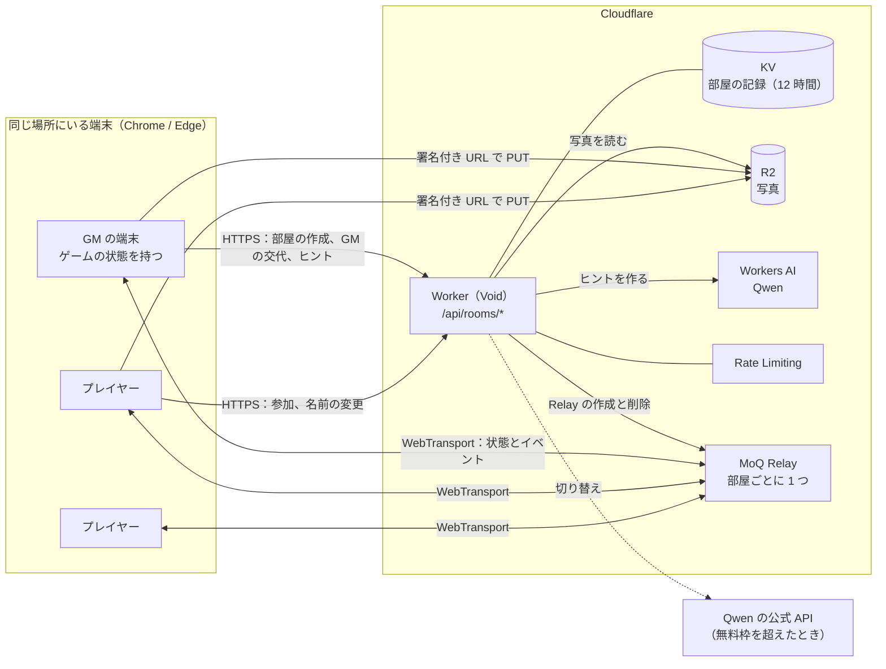
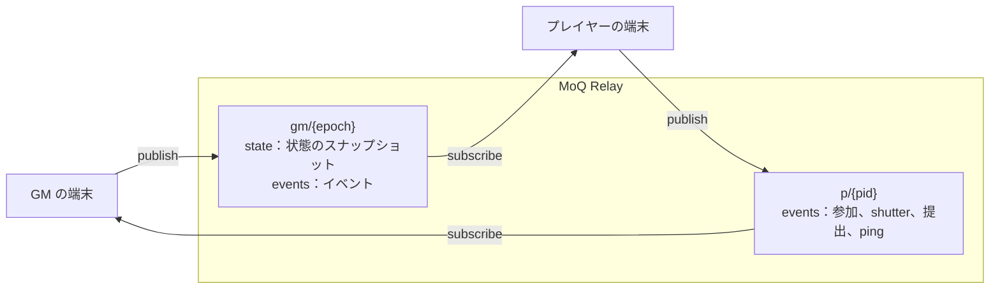
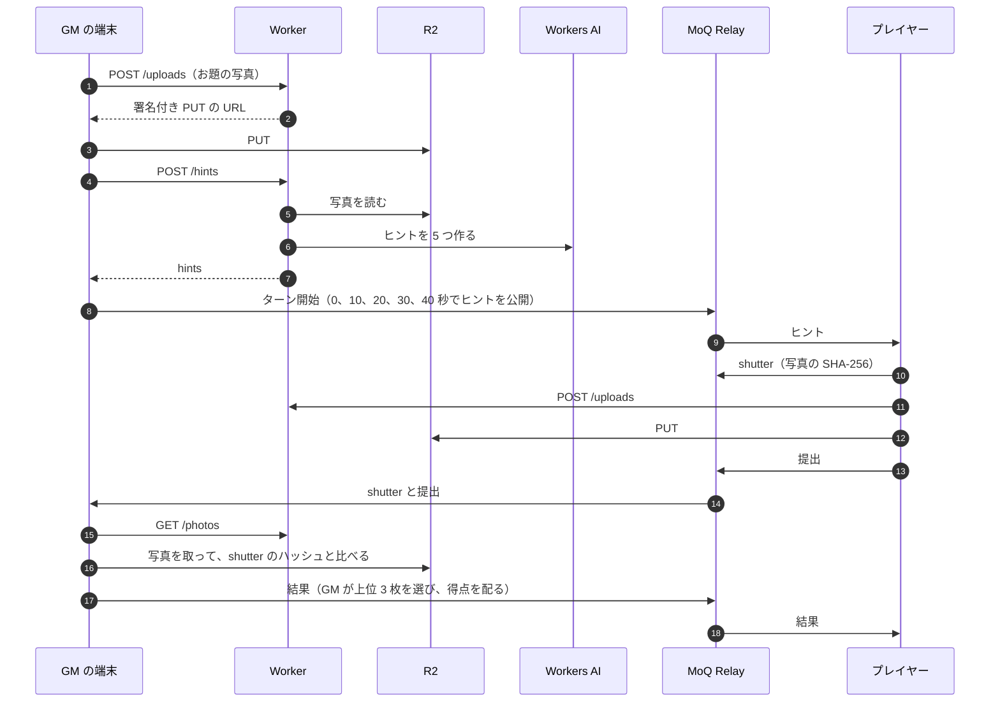

# Scene Hunter

ゲームマスター（GM）が撮った景色を、AI のヒントを頼りに探して撮る、写真さがしのパーティーゲーム。
同じ場所に集まった数人から数十人が、1 人 1 台のスマートフォンのブラウザで遊ぶ。

- 本番：<https://game.scene-hunter.workers.dev/>
- 遊び方の紹介：<https://game.scene-hunter.workers.dev/lp>

## 構成

ゲームを進めるサーバーは置いていない。
ゲームの状態は GM の端末が持ち、部屋ごとに 1 つ作る Cloudflare の MoQ Relay を通して、全員の端末へ配信する。
Worker が受け持つのは、部屋の作成と参加証の発行、写真のアップロード URL の発行、AI によるヒントの生成だけである。



| 部品              | 役割                                                                                 |
| ----------------- | ------------------------------------------------------------------------------------ |
| **Worker**        | [Void](https://void.cloud) で書いた API と、画面（React、TanStack Router）の配信。   |
| **KV**            | 部屋の番号から、Relay、言語、ラウンド数、今の GM を引く。12 時間で消える。           |
| **MoQ Relay**     | 部屋の全員をつなぐ。部屋を作るときに API で作り、解散か毎時の cron で消す。          |
| **R2**            | 写真（720p の JPEG）。端末から署名付き URL で直接 PUT する。大きさは署名で縛る。     |
| **Workers AI**    | お題の写真から 5 つのヒントを 1 回のリクエストで作る。                               |
| **Rate Limiting** | 部屋の作成、参加、ヒント、アップロードの回数を、IP、部屋、プレイヤーごとに制限する。 |

## MoQ の broadcast

GM とプレイヤーは、それぞれ自分の broadcast を Relay に出し、相手の broadcast を購読する。
プレイヤーどうしは購読しない。



- GM は接続し直すたびに epoch を 1 つ上げた `gm/{epoch}` を出し直す。プレイヤーは一番新しい epoch に付いていく。
- GM の状態は 5 秒ごとと変化のたびに `state` へ送り、端末の localStorage にも残す。GM がリロードしても続きから再開できる。
- GM が抜けたら、別の端末が GM を引き継げる（`/claim`）。

## 1 ラウンドの流れ



## 不正を防ぐしくみ

- **参加証：** Worker が Ed25519 で署名し、部屋、プレイヤー ID、役割、名前、端末の公開鍵を入れる。
- **署名付きのメッセージ：** MoQ に流すメッセージは、端末の鍵で署名した封筒に入れる。受け取った側は、参加証と署名を確かめてから使う。
- **シャッターのハッシュ：** 撮った瞬間に写真のハッシュを先に送る。後で別の写真に差し替えても、GM の端末が無効にする。
- **API の認証：** HMAC で署名した部屋のトークンで行う。

## 得点

```text
得点 = round(基本点 × (1 − 0.5 × 提出までの秒数 / 制限時間)) + min(連続 − 1, 5) × 100
基本点：1 位 1000、2 位 700、3 位 400
```

## ディレクトリ

```text
routes/api/        Worker の API（Void のファイルルーティング）
crons/             使い終わった Relay を毎時消す
src/server/        API の中身（部屋、写真、ヒント、Relay、署名付き URL）
src/shared/        端末と Worker で共有する型、署名、得点の計算、言語
src/client/game/   GM とプレイヤーのゲームの進行（GM は状態機械 gmMachine）
src/client/moq/    MoQ の接続、broadcast の購読
src/client/screens 画面
messages/          11 言語の文言（Paraglide）
tests/unit/        unit テスト（vite-plus test、happy-dom）
tests/e2e/         手元の moq-relay を使う e2e テストと、axe によるアクセシビリティの点検
tests/prod/        本番に向けた e2e テスト
```

## 開発

```sh
pnpm install
pnpm dev          # 手元で起動
pnpm test         # unit テスト
pnpm e2e          # e2e テスト（moq-relay を落として起動する）
pnpm lint && pnpm fmt:check
```

開発中は `/__screens` で全画面を代表的な値で並べて見られる（`?screen=<id>&lang=<locale>`）。

main へ push すると、Workers Builds がビルドしてデプロイする。
秘密情報の登録と鍵の作り直しは [docs/deploy.md](docs/deploy.md) に書いてある。
